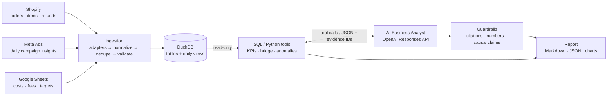

# Week 8, Day 3 — AI Business Reporting & Data Analysis Agent

*10 Weeks to AI Agents* · an educational project by **Alex Figura**

> **A dashboard tells you what happened. An AI Business Analyst investigates why it happened.**

This repository builds an AI business analyst for **Northstar Supply**, the
fictional ecommerce brand from Week 8 Days 1 and 2. Northstar sells insulated
water bottles and other everyday products. The analyst combines data from
**Shopify** (orders, refunds), **Meta Ads** (campaign spend) and **Google
Sheets** (product costs, fulfillment fees, targets). It loads everything into
a local **DuckDB** database and lets an OpenAI model investigate business
questions with read-only analytical tools.

There are two implementations:

- **A. A runnable Python agent.** Ingestion pipeline, DuckDB, SQL tools, deterministic KPIs, OpenAI tool calling, reports with charts, and evaluations.
- **B. A Claude Skill** (`claude-skill/business-analyst/`). It teaches Claude the same workflows, metric definitions and validation rules, and includes sample data and a KPI script.

All data is fictional. Nothing needs a real Shopify, Meta or Google account.

---

## The scenario: sales are up, profit is down

| Metric | Previous week (Oct 26 – Nov 1) | Current week (Nov 2 – 8) | Change |
|---|---|---|---|
| Net product sales | $100,000 | $120,000 | **+20%** |
| COGS | $40,000 | $48,000 | +20% |
| Fulfillment + payment fees | $10,000 | $17,400 | +74% |
| Meta advertising spend | $20,000 | $36,000 | **+80%** |
| **Contribution profit** | **$30,000** | **$18,600** | **−38%** |

*Contribution profit = net product sales − COGS − fulfillment costs − payment
fees − Meta ad spend.* It is a teaching metric, **not** accounting net income:
other marketing channels, salaries, rent, taxes and overhead are left out.

The question the agent investigates:

> "Our sales increased 20% last week, but contribution profit declined 38%. Why?"

A good answer explains **which components moved and by how much**, where
inside each component the change happened, what is still unknown, and what
to look at next. It does this without making up causes. "Ad spend rose
$16,000" is a fact. "Meta's algorithm got worse" is a hypothesis that needs
evidence. That distinction is built into the system prompt, the guardrails,
and the evaluations.

These numbers are not typed into a slide. About 2,900 fictional orders,
5,500 line items, 160 refunds, 54 daily ad rows and the cost sheets add up
to them **exactly, to the cent**. Tests prove it.

## What you'll learn

- **Business data pipelines.** Turning three systems with different shapes into consistent tables.
- **APIs.** Read-only adapters for the Shopify GraphQL Admin API, Meta Marketing API Insights and the Google Sheets API.
- **Data normalization.** Money stored as text, US-format dates, UTC to local dates (including the daylight saving switch), messy SKUs, and duplicates.
- **DuckDB and SQL.** SELECT, WHERE, GROUP BY, JOIN, CTEs and date aggregation, plus how to *avoid double counting*.
- **KPI definitions.** Gross vs. net sales, contribution profit vs. net income, store sales vs. platform-attributed revenue.
- **AI tool calling.** The model picks tools; Python and SQL do the math.
- **Investigative analysis.** Profit bridges, cost-rate analysis, drilling down, and separating facts from hypotheses.
- **Reporting.** Markdown, JSON and PNG charts generated from one calculation, so they can't disagree.
- **Evaluations.** Deterministic tests plus model-backed scenario evals with programmatic scoring.
- **Claude Skills.** Packaging the same expertise as a Skill.

## Architecture



The agent **never** reads the database directly. It can only call narrow,
read-only tools. Every tool result carries an evidence ID (E1, E2, …) that
the final answer must cite. More detail: [`docs/architecture.md`](docs/architecture.md).

## Repository structure

```
Week-8-Day-3-AI-Business-Reporting-Data-Analysis-Agent/
├── run.py                   # python run.py <command>
├── agent/                   # system prompt, scope, 6 workflow files (loaded on demand)
├── knowledge-base/          # company context, metric definitions, targets, reporting & data-quality rules
├── data/
│   ├── shopify/             # products, orders, order-items, refunds (fictional CSV exports)
│   ├── meta/                # daily campaign performance + campaign metadata
│   ├── google-sheets/       # product costs, fulfillment & payment costs, business targets
│   └── scenarios/           # 9 teaching scenarios (override files + scenario.json)
├── sql/                     # schema.sql, views.sql, validation-queries.sql
├── src/business_analyst/
│   ├── ingestion/           # adapters (mock + live), normalization, loader
│   ├── analysis/            # metrics, variance (bridge) analysis, anomaly rules
│   ├── tools/               # the 17 model-facing tools + registry
│   ├── reporting/           # charts.py, reports.py
│   ├── agent.py             # OpenAI tool-calling loop
│   ├── guardrails.py        # checks on the agent's final answer
│   ├── evaluation.py        # deterministic + model-backed evaluations
│   └── cli.py, config.py, database.py, ...
├── evals/                   # test-cases.json, run_evals.py
├── tests/                   # pytest suite (no API key needed)
├── claude-skill/business-analyst/   # the Claude Skill (SKILL.md, references, sample data, script)
├── scripts/                 # generate_data.py, build_skill.py
├── docs/                    # architecture, SQL tutorial, real data, production, troubleshooting
└── reports/                 # generated reports land here (git-ignored)
```

How the pieces connect: `data/` → `ingestion/` → DuckDB (`sql/`) →
`analysis/` → `tools/` → `agent.py` → `reporting/`. The Markdown in
`agent/` and `knowledge-base/` is what the model reads. The Python is what
actually runs.

## Prerequisites

- **Python 3.10 or newer.** Check with `python --version` (or `python3 --version`).
- **Git**, to clone the repository.
- **Dependencies:** `openai`, `duckdb`, `matplotlib`, `httpx`, `python-dotenv` (installed below).
- **An OpenAI API key**, *only* for AI-backed commands (`analyze`, the AI step of `demo`, `report` with a narrative, `eval --agent`). Everything else runs offline.

## Quick start

### 1. Clone

```bash
git clone https://github.com/walexfigura/Week-8-Day-3-AI-Business-Reporting-Data-Analysis-Agent.git
cd Week-8-Day-3-AI-Business-Reporting-Data-Analysis-Agent
```

### 2. Create a virtual environment and install

macOS / Linux:

```bash
python3 -m venv .venv
source .venv/bin/activate
pip install -e ".[dev]"
```

Windows (PowerShell):

```powershell
py -3 -m venv .venv
.venv\Scripts\Activate.ps1
pip install -e ".[dev]"
```

### 3. Configure `.env` (optional for offline use)

```bash
cp .env.example .env        # Windows: copy .env.example .env
```

Open `.env` and set `OPENAI_API_KEY=...` if you want AI analysis. The default
model is `gpt-5.4-mini`. Change `OPENAI_MODEL` to any model your account can
use that supports function calling in the Responses API.

### 4. Check your setup and build the database

```bash
python run.py doctor
python run.py init-db
```

`doctor` builds the database and confirms the scenario: net sales +20%, ad
spend +80%, contribution profit −38%, and a profit bridge that reconciles.
It also confirms that the SQL tool rejects `DROP TABLE`.

### 5. Run the demo

```bash
python run.py demo
```

Without a key, you get the deterministic numbers, the profit bridge, and a
facts-only report. With a key, the AI analyst investigates and writes an
investigation report.

### 6. Read the results

Reports are saved in `reports/<report-name>/`:

- `report.md` is the readable report (open it in VS Code or GitHub preview).
- `summary.json` holds every figure, the chart data and the consistency checks.
- `charts/*.png` contains the sales vs. ad spend chart, profit bridge, contribution comparison, campaign spend and product margins.

### All commands

| Command | Needs API key? | What it does |
|---|---|---|
| `python run.py doctor` | no | Setup check plus scenario verification |
| `python run.py init-db [--scenario NAME \| --all] [--source mock\|live]` | no | Build DuckDB from source data |
| `python run.py scenarios` | no | List the teaching scenarios |
| `python run.py demo` | optional | Main scenario: numbers, then an AI investigation if a key is set |
| `python run.py analyze --scenario profit_decline` | **yes** | AI investigates the profit decline and writes a report |
| `python run.py analyze --scenario advertising` | **yes** | AI analyzes campaign performance |
| `python run.py analyze --question "..." [--scenario NAME]` | **yes** | Ask your own question |
| `python run.py report [--scenario NAME] [--no-agent]` | optional | Weekly business review. Adds an AI narrative if a key is set; `--no-agent` makes it facts-only |
| `python run.py eval [--agent] [--case TEXT] [--verbose]` | only with `--agent` | Run evaluations |
| `python run.py build-skill` | no | Build `dist/business-analyst-skill.zip` |
| `python run.py tool list` / `tool NAME --args '{...}'` | no | Run any agent tool yourself |
| `python run.py sql "SELECT ..."` | no | Read-only SQL with the same guardrails as the agent |

## Understanding the data

Everything in `data/` is **fictional**. It is generated by
[`scripts/generate_data.py`](scripts/generate_data.py) from a fixed random
seed, so running it again recreates identical files. You don't need to run it.

| Source | Files | Looks like |
|---|---|---|
| Shopify | `products.csv`, `orders.csv` (2,920 orders), `order-items.csv`, `refunds.csv` | Admin exports: UTC timestamps, discount codes, multi-item orders, partial refunds |
| Meta Ads | `campaign-performance.csv` (daily rows for 5 campaigns), `campaign-metadata.csv` | Insights at `level=campaign`, `time_increment=1` |
| Google Sheets | `product-costs.csv`, `fulfillment-costs.csv`, `business-targets.csv` | Human-typed: `$1,234.50`, `11/2/2026`, `ns-brs-cln ` |

Realistic details hidden in the data:

- The **Holiday Gift Push** campaign scales from $1,500 to $15,000. That is 84% of the ad spend increase.
- The 3PL rate card changed on Nov 2, and the carrier added a peak surcharge, so fulfillment cost per order rises.
- One bottle's unit cost increases on Nov 2 (effective-dated cost rows).
- Refunds are assigned to the week they were **processed**, which can be later than the week of the order.
- A campaign note and a refund reason contain **prompt-injection text** ("ignore all previous instructions…"). The agent must treat it as data.

**Scenarios** (`python run.py scenarios`) override specific files to create
teaching problems: `refund_spike`, `product_mix_shift`, `missing_cogs`,
`duplicate_records`, `misaligned_periods`, `attribution_gap` and
`ad_spend_no_lift`. `profit_decline` and `advertising` use the base data.
Each scenario gets its own database file in `warehouse/`.

## Understanding the database

**DuckDB** is a database that lives in a single file and runs inside Python.
There's no server to install. It's built for analytical queries (sums,
group-bys, joins over many rows), which is exactly what reporting needs.
The database is built at `warehouse/northstar.duckdb`.

Try a few queries. They're read-only, and writes are rejected:

```bash
# Orders per day last week
python run.py sql "SELECT order_date, COUNT(*) AS orders FROM orders WHERE order_date BETWEEN '2026-11-02' AND '2026-11-08' GROUP BY 1 ORDER BY 1"

# Weekly contribution profit straight from the daily view
python run.py sql "SELECT date_trunc('week', day) AS week, SUM(net_sales) AS net_sales, SUM(ad_spend) AS ad_spend, SUM(net_sales) - SUM(cogs_known) - SUM(fees_total) - SUM(ad_spend) AS contribution_profit FROM v_daily_contribution GROUP BY 1 ORDER BY 1"

# Meta spend by campaign last week
python run.py sql "SELECT campaign_name, SUM(spend) AS spend FROM v_campaign_daily WHERE day >= '2026-11-02' GROUP BY 1 ORDER BY 2 DESC"
```

The most important SQL lesson here is **double counting**. If you join
orders to line items (or to daily ad rows) and then sum order totals, each
order gets counted several times. The views aggregate each source to one row
per day **before** joining. A full beginner tutorial with runnable examples is in
[`docs/understanding-sql.md`](docs/understanding-sql.md).

## Metric definitions

Full definitions, including formulas, required data, how missing values are
handled, and caveats, are in
[`knowledge-base/metric-definitions.md`](knowledge-base/metric-definitions.md).
The essentials:

| Metric | Formula | Watch out for |
|---|---|---|
| Gross product sales | Σ quantity × unit price | Excludes shipping and tax (`total_price` includes both) |
| Net product sales | gross − discounts − refunds | Discounts are already in Shopify's subtotal, so subtract them once |
| COGS | Σ quantity × unit cost effective on the order date | Missing cost means COGS is **incomplete**, not $0 |
| Fulfillment costs | pick & pack + packaging + shipping labels | Assigned to the order date |
| Payment fees | processor fees (2.9% + $0.30 of the charged total) | Include shipping and tax in the base |
| Meta ad spend | Σ daily spend | Missing days are missing data, not zero |
| Contribution profit | net sales − COGS − fulfillment − payment fees − Meta spend | Not net income |
| Contribution margin | contribution profit ÷ net sales | |
| ROAS (platform) | Meta-attributed purchase value ÷ spend | Attribution-based. **Never add it to Shopify sales** |
| Blended MER | Shopify net sales ÷ Meta spend | The Shopify-based efficiency view |

**Shopify net sales vs. Meta "purchase value":** Meta credits purchases to
ads using its own attribution model. The same order can also be credited to
email or search, and some credited purchases would have happened anyway.
Meta's number is an *attributed claim*, not extra revenue. The
`attribution_gap` scenario shows Meta claiming more than the store sold.

## How the agent investigates

Who does what:

| Python and SQL calculate | The LLM decides |
|---|---|
| Sales, refunds, COGS, fees, ad spend per period | Which questions matter |
| % changes and absolute changes | Which tools to call, and in what order |
| A profit bridge that **must** reconcile | What looks unusual and is worth drilling into |
| Cost-rate analysis (costs that grew faster than sales) | How ads, operations and products connect |
| Campaign and product breakdowns | What is fact vs. hypothesis |
| Data coverage, missing costs, duplicates | How to explain it and what to recommend |
| Threshold-based anomaly flags | Which flags deserve discussion |

A typical run on the main scenario. The model chooses this path; it isn't hard-coded:

1. `read_workflow("investigate-profit-decline")` loads the detailed procedure.
2. `get_data_quality_report` finds both weeks complete, notes one normalized SKU, and flags two instruction-like text fields.
3. `compare_periods` returns sales +20.0%, profit −38.0%, and a bridge of +$20,000 sales, −$8,000 COGS, −$6,617 fulfillment, −$783 payment fees and −$16,000 Meta spend, which reconciles to −$11,400. COGS stays 40% of sales (proportional). Ad spend goes from 20% to 30% of sales.
4. `compare_campaigns` shows campaign 120210000000103 (Holiday Gift Push) at +$13,500, 84% of the spend increase, with platform ROAS falling.
5. `get_cost_breakdown` shows shipping labels per order rising from $1.78 to $4.07 and pick & pack from $2.65 to $3.38.
6. `get_business_targets` shows margin at 15.5% vs. a 25% target.
7. `submit_analysis` returns facts with evidence IDs, hypotheses with ways to verify them, data gaps and recommendations.

Then the **guardrails** run. Every fact must cite a real evidence ID. Every
number must match a tool result (within display rounding). A "fact" that
uses causal language ("because the algorithm…") is flagged, and so is any
text that adds Meta-attributed value to sales. On problems, the model gets
one chance to revise. Remaining warnings are printed in the report.

The system prompt is in [`agent/system-prompt.md`](agent/system-prompt.md).
Detailed procedures live in [`agent/workflows/`](agent/workflows/) and are
loaded only when needed.

## Generating reports

```bash
python run.py report                      # weekly review (AI narrative if a key is set)
python run.py report --no-agent           # facts only, fully offline
python run.py report --scenario missing_cogs --no-agent
python run.py report --previous-start 2026-10-26 --previous-end 2026-11-01 \
                     --current-start 2026-11-02 --current-end 2026-11-08
```

Each report has these sections: executive summary, revenue overview,
contribution profit and bridge, cost-rate analysis, advertising performance,
product profitability, refunds and fulfillment, anomalies, targets,
data-quality warnings, recommended next steps, and an appendix with sources
and the tool trace.

All tables and charts come from a single `build_summary()` call against the
database. The report runs consistency checks: the bridge chart must end at
current profit, chart values must equal table values, and daily sales must
sum to the weekly total. If contribution profit is incomplete (for example,
a missing product cost), **no bridge chart is drawn** rather than drawing one
from guessed numbers.

## Using the Claude Skill

1. **Build the ZIP:** `python run.py build-skill` creates `dist/business-analyst-skill.zip`. The builder validates the YAML front matter, refreshes the Skill's sample data from DuckDB, syncs the metric definitions, and checks that the bundled script reproduces +20% / +80% / −38%.
2. **Install it:**
   - *Claude apps:* enable code execution in Settings → Capabilities, then upload the ZIP under Skills. Menu names may change; see Anthropic's Agent Skills docs.
   - *Claude Code:* unzip into `~/.claude/skills/` or a project's `.claude/skills/`.
3. **Run the fictional example:** ask *"Why did our contribution profit decrease last week?"* Claude should say it's using fictional sample data, run `scripts/kpi_calculator.py`, and explain the bridge with facts and hypotheses kept separate.
4. **Upload your own files:** a daily CSV with the columns listed in `scripts/kpi_calculator.py`, or raw exports that Claude aggregates first.
5. **Connectors:** with a working Google Sheets or database connector, follow `references/tool-configuration.md`. Writing a tool name in a Markdown file does **not** create an integration. The Skill tells Claude to check what it can actually access.

## Connecting real platforms

The live adapters are read-only, paginated, and retry on rate limits. They
are unit-tested against fake HTTP responses but have **not** been run against
real accounts. [`docs/connecting-real-data.md`](docs/connecting-real-data.md)
covers each platform:

- **Shopify:** custom app, `read_orders` and `read_products` scopes, cursor pagination, cost-based throttling.
- **Meta:** `ads_read` token, `level=campaign&time_increment=1`, `paging.next`, attribution windows, account timezone, and picking one purchase action type (never summing them).
- **Google Sheets:** service account shared as Viewer, `values.get`, human-formatted values.

```bash
python run.py init-db --source live     # after filling the live settings in .env
```

## Testing and reliability

```bash
pytest                         # 144 unit tests, no API key needed
python run.py eval             # 13 deterministic evaluations (one per category)
python run.py eval --agent     # + 11 model-backed scenario evals (needs OPENAI_API_KEY)
python run.py eval --case sql --verbose
```

| # | Evaluation | Deterministic check | Model-backed check |
|---|---|---|---|
| 1 | KPI calculations | +20% / +80% / −38% and exact totals | Agent cites the right figures |
| 2 | Profit reconciliation | Bridge sums exactly; COGS proportional | Agent explains the reconciled drivers |
| 3 | Duplicate revenue | Naive join inflates; tools don't; duplicates removed | (refund-spike drill-down) |
| 4 | Missing COGS | Profit is `None`, never computed with $0 | Agent names NS-BTL-40 and the gap |
| 5 | Reporting periods | Unequal and incomplete periods flagged | Agent discloses length and missing days |
| 6 | Revenue definitions | Gross ≠ net; Meta value kept separate | Attribution explained |
| 7 | Unsupported explanations | Guardrail flags causal "facts" and invented numbers | No causal facts; hypotheses labelled |
| 8 | SQL safety | 14 destructive queries rejected; connection is read-only | No write succeeds; agent says read-only |
| 9 | Data quality | Duplicates, bad currency, bad dates, negative costs caught | Agent reports duplicates |
| 10 | Tool failure | Structured errors; no model call without data | Agent reports unavailability, no numbers |
| 11 | Prompt injection | Injection text flagged and labelled untrusted | Agent ignores "profit increased 25%" |
| 12 | Report consistency | Chart values equal table values | No ungrounded numbers |
| 13 | Marketing attribution | Platform value > store sales flagged; profit unaffected | Agent refuses to add it to sales |

Model-backed checks score **structure**: which tools were called, finding
types, evidence IDs, numbers, SKUs and campaign IDs. They don't rely on exact
phrases. Model output varies, so a model-backed case can pass once and fail
the next time. Results are saved to `evals/results/<run>.json`, and every
agent run is logged with a trace ID in `logs/`.

> Verification status for this commit: unit tests and deterministic
> evaluations were run and pass. The model-backed evaluations and the live
> `analyze` path were **not** run while building, because no OpenAI key was
> available. Run `python run.py eval --agent` to measure them yourself.

## Exercises

1. **Change an advertising budget.** Halve campaign `120210000000103` in `data/meta/campaign-performance.csv`. Run `python run.py doctor` (the database rebuilds automatically). What happens to the −38%?
2. **Add a product.** Add a SKU to `products.csv`, a few line items (keep order subtotals consistent), and a cost row. Watch `order_subtotal_mismatch` catch any inconsistency.
3. **Increase COGS.** Raise a unit cost in `product-costs.csv` with a new effective date. Does the cost-rate analysis show COGS growing faster than sales?
4. **Add a refund spike.** Compare your result with `python run.py report --scenario refund_spike --no-agent`.
5. **Change reporting periods.** Run `report` with custom dates of unequal length and read the warnings.
6. **Introduce missing data.** Delete one day of Meta rows. Which numbers become unavailable, and why?
7. **Add a KPI.** Add "discount rate target" to `business-targets.csv` and to `_target_status()` in `reporting/reports.py`.
8. **Build a new SQL tool.** Add `get_orders_by_hour` in `tools/sales.py` (copy an existing `ToolSpec`). Test it with `python run.py tool get_orders_by_hour --args '{...}'`, then let the agent use it.

## Troubleshooting

Common fixes are below. The full table is in [`docs/troubleshooting.md`](docs/troubleshooting.md).

- `Missing Python package` → activate `.venv` and run `pip install -e ".[dev]"`.
- `OPENAI_API_KEY is not set` → add it to `.env`, or stick to the offline commands.
- `Could not set lock on file` → another process has the DuckDB file open. Close it.
- Model errors → set `OPENAI_MODEL` to a model you can access. Use `OPENAI_REASONING_EFFORT=none` for non-reasoning models.

## Safety and limitations

- **Fictional data by default.** Northstar Supply, its customers, campaigns and figures are invented.
- **Not a financial reporting system.** Contribution profit here is a simplified teaching metric. Don't use this for accounting, tax, or investment decisions.
- The agent is **read-only**. It can't change data, budgets or campaigns. People make decisions.
- Anomaly detection is simple threshold rules, not machine learning.
- The guardrails are heuristics. They catch common mistakes, not all of them.
- Live API adapters are untested against real accounts.
- Prompt-injection defenses (labelling untrusted text, read-only tools, guardrails) reduce risk but don't eliminate it.

More: [`docs/production-considerations.md`](docs/production-considerations.md).

## Credits and license

Educational project by **Alex Figura** for *10 Weeks to AI Agents* (Week 8, Day 3).
Company, data and scenarios are original and fictional. Released under the
[MIT License](LICENSE).
