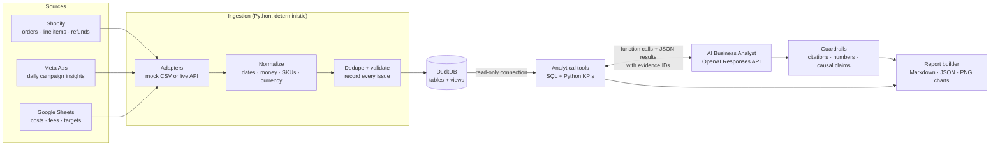

# Architecture

## The big idea: keep business data and AI reasoning apart

The language model never sees raw files and never touches the database
directly. It can only call **narrow, read-only tools**. Every number it
reports comes back from a tool with an evidence ID; Python and SQL do the
arithmetic.

Why this split matters:

| Concern | Handled by | Why not the LLM? |
|---|---|---|
| Parsing `$1,234.50`, UTC → New York dates | `ingestion/normalization.py` | Must be identical every run |
| Joining orders, items, costs, ads | `sql/views.sql` | Easy to double-count; needs tests |
| KPIs, % changes, bridge | `analysis/` | Arithmetic must be exact and auditable |
| Threshold anomalies | `analysis/anomalies.py` | Transparent rules people can disagree with |
| Which question to ask next | **LLM** | Judgment, prioritization |
| Connecting findings across ads, ops, products | **LLM** | Synthesis |
| Explaining, recommending, stating uncertainty | **LLM** | Language |
| Checking the LLM's claims | `guardrails.py` | Never let the model grade itself alone |

## Components

| Path | Responsibility |
|---|---|
| `src/business_analyst/ingestion/` | Adapters (`shopify.py`, `meta_ads.py`, `google_sheets.py`), normalization, de-duplication, and `loader.py`, which builds a fresh DuckDB file and swaps it in atomically |
| `sql/schema.sql` | Tables, one grain each, DECIMAL money |
| `sql/views.sql` | Daily, pre-aggregated views; `v_daily_contribution` combines sources only after each is one row per day |
| `sql/validation-queries.sql` | Named checks that return rows only when something is wrong |
| `src/business_analyst/database.py` | Read-only connections, safe SQL validation, row limit, timeout |
| `src/business_analyst/analysis/` | `metrics.py` (KPIs), `variance_analysis.py` (bridge, cost rates, campaign/product changes), `anomalies.py` |
| `src/business_analyst/tools/` | The 17 model-facing tools + registry (validation, evidence IDs, error handling) |
| `src/business_analyst/agent.py` | The tool-calling loop (OpenAI Responses API) |
| `src/business_analyst/guardrails.py` | Post-hoc checks on the final answer |
| `src/business_analyst/reporting/` | One `build_summary()` call → tables, charts, JSON |
| `src/business_analyst/evaluation.py` | Deterministic and model-backed evaluations |
| `agent/` | System prompt, scope, workflows (loaded on demand via `read_workflow`) |
| `knowledge-base/` | Metric definitions and business rules |

## One agent run, step by step

1. `analyze` builds or reuses the DuckDB file for the scenario. It rebuilds automatically if source CSVs changed.
2. The agent opens a **read-only** connection and sends the question plus
   the reporting periods to the model, with 17 tools and `submit_analysis`.
3. The model typically calls `read_workflow`, then `get_data_quality_report`,
   `compare_periods`, and drills down (`compare_campaigns`, `get_cost_breakdown`, ...).
   The path is not hard-coded.
4. Each tool result gets an evidence ID (E1, E2, ...) and is logged to `logs/YYYY-MM-DD.jsonl` with a trace ID.
5. The model calls `submit_analysis` with findings typed as `observed_fact`,
   `calculation` or `hypothesis`.
6. Guardrails check citations, numbers, causal language and attribution mixing.
   On problems the model gets **one** revision request.
7. The report builder renders tables and charts from the database, adds the
   narrative, and runs chart/table consistency checks.

Limits: `AGENT_MAX_ITERATIONS` (12 model calls) and `AGENT_MAX_TOOL_CALLS` (30).

## Progressive disclosure of instructions

The system prompt is about 150 lines. Detailed procedures live in
`agent/workflows/*.md` and are loaded only when relevant through the
`read_workflow` tool. Metric details come from `explain_metric_definition`.
This keeps the always-on prompt focused and makes each procedure easy to edit and test.

## Mock vs. live

`DATA_SOURCE=mock` (default) reads `data/`. `DATA_SOURCE=live` (or
`init-db --source live`) uses the read-only API adapters. Both produce the
same `RawTable` shapes, so everything after the adapters is shared. The live
adapters are unit-tested against fake HTTP responses only — see
`connecting-real-data.md`.
